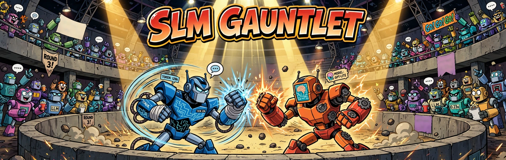

<p align="center">
  
</p>

<p align="center"><sub><b>320 tasks · 14 suites · 32 models ranked</b> — best 90.2% on 8 GB. The arena is illustration, not data; the board is <a href="SCOREBOARD.md">SCOREBOARD.md</a>.</sub></p>

# SLM Gauntlet

A benchmark for **small language models** (sub-12B class) that runs on whatever device you have — NVIDIA, AMD, or Apple Silicon. The card generator auto-detects your GPU and its memory, so every model card shows **your** hardware, not ours. It measures whether they can actually **do work as subagents** — call tools correctly, recover from errors, follow instructions precisely, and retrieve facts from long context — not just answer trivia.

**Start with [`SCOREBOARD.md`](SCOREBOARD.md)** — every board on one screen, each labelled with the hardware it was measured on, single-run cells marked as such. This README explains the method; the scoreboard is the result.

<!-- BEGIN GENERATED LEADERBOARD: scripts/leaderboard_check.py -->

**Current leaderboard — 320 tasks, scorer 0.6.0, NVIDIA GTX 1070 Ti 8 GB, all layers on-GPU, zero CPU offload, temp 0, seed 1.**

One row per model: the **best-scoring configuration** of that model in the corpus (63 scored configurations behind this table). Every score is the weighted aggregate defined in `scripts/leaderboard_check.py`, recomputed from that run's own log, which ships with the corpus (`results/<model>_<timestamp>.json`): `python3 scripts/leaderboard_check.py` re-derives this table from a clone and exits non-zero on any disagreement. The model's card (`results/cards/*.json`) carries the per-suite result the score is computed from. The `Method` column carries the task count and scorer version for the row, so no row is ever compared across methodologies. Full per-configuration data: [`results/_published/LEADERBOARD.md`](results/_published/LEADERBOARD.md).

| Rank | Model | Best configuration | Score | Tool | Adv | Chains | Struct | Retr | Code | Instr | Method | Card |
|---|---|---|---|---|---|---|---|---|---|---|---|---|
| 🥇 | Gemma 4 E4B | Q4_K_M · KV q8_0 · 32K ctx | **90.2%** | 95% | 90% | 83% | 100% | 100% | 100% | 72% | 320 t · 0.6.0 | [png](results/cards/card_gemma4-e4b-q4km-kvq8.png) |
| 🥈 | Bolt E4B | UD-IQ3_XXS · KV q8_0 · 32K ctx | **89.7%** | 95% | 90% | 83% | 100% | 86% | 100% | 83% | 320 t · 0.6.0 | [png](results/cards/card_bolt-e4b-udiq3xxs-kvq8.png) |
| 🥉 | Qwen3.5-9B | Q4_K_M · KV q4_0 · 32K ctx | **86.2%** | 89% | 80% | 100% | 80% | 86% | 100% | 56% | 320 t · 0.6.0 | [png](results/cards/card_qwen3.5-9b-q4km-kvq4.png) |
| 4 | Spark-X2.6-4B | Q8_0 · KV q4_0 · 32K ctx | **86.0%** | 89% | 100% | 100% | 90% | 100% | 90% | 61% | 320 t · 0.6.0 | [png](results/cards/card_spark-x2.6-4b-q8-kvq4.png) |
| 5 | MiMo-V2.6-9B | Q4_K_M · KV FP16 · 32K ctx | **84.8%** | 100% | 80% | 100% | 70% | 71% | 100% | 56% | 320 t · 0.6.0 | [png](results/cards/card_mimo-v2.6-9b-q4km-kvf16.png) |
| 6 | Ornith-1.5-9B | Q4_K_M · KV FP16 · 32K ctx | **84.2%** | 84% | 60% | 100% | 90% | 100% | 80% | 67% | 320 t · 0.6.0 | [png](results/cards/card_ornith-1.5-9b-q4km-kvf16.png) |
| 7 | Gemma 4 E2B | Q4_0 · KV q8_0 · 32K ctx | **83.5%** | 82% | 80% | 83% | 80% | 100% | 100% | 78% | 320 t · 0.6.0 | [png](results/cards/card_gemma4-e2b-q4_0-kvq8.png) |
| 8 | Qwen3.5-4B | Q4_K_M · KV FP16 · 32K ctx | **83.3%** | 89% | 70% | 100% | 70% | 100% | 80% | 50% | 320 t · 0.6.0 | [png](results/cards/card_qwen3.5-4b-q4km-kvf16.png) |
| 9 | ZoomGain-4B | Q4_K_M · KV q8_0 · 32K ctx | **82.8%** | 89% | 70% | 100% | 60% | 86% | 90% | 78% | 320 t · 0.6.0 | [png](results/cards/card_zoomgain-4b-q4km-kvq8.png) |
| 10 | ZwZ2-4B | Q4_K_M · KV q8_0 · 32K ctx | **81.3%** | 89% | 70% | 100% | 60% | 100% | 80% | 61% | 320 t · 0.6.0 | [png](results/cards/card_zwz2-4b-q4km-kvq8.png) |
| 11 | MiniCPM5-2B | Q4_K_M · KV FP16 · 32K ctx | **80.3%** | 95% | 90% | 83% | 80% | 100% | 90% | 83% | 320 t · 0.6.0 | [png](results/cards/card_minicpm5-2b-q4km-kvf16.png) |
| 12 | Gemma 4 12B | UD-Q2_K_XL · KV q8_0 · 32K ctx | **79.5%** | 79% | 90% | 83% | 80% | 71% | 60% | 67% | 320 t · 0.6.0 | [png](results/cards/card_gemma4-12b-udq2kxl-kvq8.png) |
| 13 | Ministral 3 8B | Q4_K_M · KV q8_0 · 32K ctx | **79.5%** | 89% | 60% | 100% | 40% | 86% | 90% | 78% | 320 t · 0.6.0 | [png](results/cards/card_ministral3-8b-q4km-kvq8.png) |
| 14 | Ternary-Bonsai-2 9B | Q2_0 · KV q8_0 · 32K ctx | **79.2%** | 89% | 80% | 100% | 90% | 14% | 90% | 61% | 320 t · 0.6.0 | [png](results/cards/card_ternary-bonsai-2-9b-q2-kvq8.png) |
| 15 | Sharp-Spark-4B | Q4_K_XL · KV q8_0 · 32K ctx | **76.9%** | 63% | 90% | 50% | 100% | 71% | 90% | 61% | 320 t · 0.6.0 | [png](results/cards/card_sharp-spark-4b-q4kxl-kvq8.png) |
| 16 | Dory 1.0 4B | Q5_K_M · KV q8_0 · 32K ctx | **76.5%** | 74% | 80% | 100% | 50% | 100% | 80% | 44% | 320 t · 0.6.0 | [png](results/cards/card_dory-1.0-4b-q5km-kvq8.png) |
| 17 | Granite 4.2 8B | Q4_K_M · KV q8_0 · 32K ctx | **74.2%** | 95% | 80% | 100% | 60% | 100% | 40% | 50% | 320 t · 0.6.0 | [png](results/cards/card_granite4.2-8b-q4km-kvq8.png) |
| 18 | Spark-X2.6-1.7B | Q4_K_M · KV q8_0 · 32K ctx | **68.9%** | 77% | 90% | 100% | 50% | 57% | 20% | 56% | 320 t · 0.6.0 | [png](results/cards/card_spark-x2.6-1.7b-q4km-kvq8.png) |
| 19 | Ministral 3 3B | Q4_K_M · KV q8_0 · 32K ctx | **68.9%** | 89% | 70% | 83% | 50% | 71% | 60% | 72% | 320 t · 0.6.0 | [png](results/cards/card_ministral3-3b-q4km-kvq8.png) |
| 20 | Qwen3.5-2B | Q4_K_M · KV q8_0 · 32K ctx | **67.3%** | 79% | 80% | 100% | 30% | 57% | 60% | 67% | 320 t · 0.6.0 | [png](results/cards/card_qwen3.5-2b-q4km-kvq8.png) |
| 21 | LFM3-1.7B | Q4_K_M · KV q8_0 · 32K ctx | **66.5%** | 84% | 50% | 83% | 40% | 57% | 80% | 50% | 320 t · 0.6.0 | [png](results/cards/card_lfm3-1.7b-q4km-kvq8.png) |
| 22 | Granite 4.2 3B | Q4_K_M · KV q8_0 · 32K ctx | **65.7%** | 89% | 80% | 67% | 50% | 86% | 20% | 33% | 320 t · 0.6.0 | [png](results/cards/card_granite4.2-3b-q4km-kvq8.png) |
| 23 | Gemma 3n E4B | Q4_K_M · KV q8_0 · 32K ctx | **64.7%** | 26% | 50% | 17% | 70% | 43% | 90% | 61% | 320 t · 0.6.0 | [png](results/cards/card_gemma3n-e4b-q4km-kvq8.png) |
| 24 | Nemotron 3 Nano 4B | Q4_K_M · KV q8_0 · 32K ctx | **64.0%** | 74% | 60% | 67% | 50% | 29% | 70% | 39% | 320 t · 0.6.0 | [png](results/cards/card_nemotron3-nano-4b-q4km-kvq8.png) |
| 25 | LFM2.5-2.6B | Q4_K_M · KV q8_0 · 32K ctx | **62.3%** | 79% | 50% | 83% | 60% | 14% | 30% | 50% | 320 t · 0.6.0 | [png](results/cards/card_lfm2.5-2.6b-q4km-kvq8.png) |
| 26 | Llama 3.1 8B | Q4_K_M · KV q8_0 · 32K ctx | **61.8%** | 16% | 40% | 17% | 60% | 100% | 90% | 56% | 320 t · 0.6.0 | [png](results/cards/card_llama-3.1-8b-q4km-kvq8.png) |
| 27 | Ternary-Bonsai-2 2B | Q2_0 · KV q8_0 · 32K ctx | **60.9%** | 72% | 80% | 83% | 40% | 57% | 40% | 56% | 320 t · 0.6.0 | [png](results/cards/card_ternary-bonsai-2-2b-q2-kvq8.png) |
| 28 | LFM2.5-8B-A1B | UD-Q4_K_M · KV q8_0 · 32K ctx | **54.7%** | 84% | 60% | 67% | 20% | 14% | 30% | 50% | 320 t · 0.6.0 | [png](results/cards/card_lfm2.5-8b-a1b-udq4km-kvq8.png) |
| 29 | Qwen3.5-0.8B | Q4_K_M · KV q8_0 · 32K ctx | **54.6%** | 63% | 60% | 100% | 40% | 57% | 10% | 39% | 320 t · 0.6.0 | [png](results/cards/card_qwen3.5-0.8b-q4km-kvq8.png) |
| 30 | MiniCPM-V 4.7 1B | Q4_K_M · KV q8_0 · 32K ctx | **53.5%** | 60% | 60% | 83% | 50% | 29% | 40% | 44% | 320 t · 0.6.0 | [png](results/cards/card_minicpmv47-1b-q4km-kvq8.png) |
| 31 | LFM2.5-1.2B | Q4_K_M · KV q8_0 · 32K ctx | **53.1%** | 58% | 70% | 100% | 40% | 71% | 40% | 44% | 320 t · 0.6.0 | [png](results/cards/card_lfm2.5-1.2b-q4km-kvq8.png) |
| 32 | MiniCPM5-1B | Q4_K_M · KV q8_0 · 32K ctx | **45.9%** | 47% | 60% | 50% | 30% | 71% | 30% | 56% | 320 t · 0.6.0 | [png](results/cards/card_minicpm5-1b-q4km-kvq8.png) |

**Legacy rows — NOT comparable, kept for provenance:** one row per model, its best-scoring pre-0.5.0 configuration; the 243 configurations behind them are listed in [`results/_published/LEADERBOARD.md`](results/_published/LEADERBOARD.md).

| Model | Best legacy configuration | Configurations | Score | Why it is not comparable |
|---|---|---|---|---|
| Bolt E4B | UD-IQ3_XXS · KV FP16 · 32K ctx | 27 | 86.6% | scorer 0.5.0 (pre-0.6.0) |
| Dory 1.0 4B | Q5_K_M · KV q4_0 · 32K ctx | 1 | 87.5% | scorer v0.3.1 (pre-0.6.0) |
| Gemma 3n E4B | Q4_K_M · KV FP16 · 32K ctx | 1 | 52.4% | scorer 0.5.0 (pre-0.6.0) |
| Gemma 4 12B | UD-Q2_K_XL · KV FP16 · 32K ctx | 1 | 43.7% | scorer 0.5.0 (pre-0.6.0) |
| Gemma 4 E4B | Q4_K_M · KV FP16 · 32K ctx | 1 | 86.3% | scorer 0.5.0 (pre-0.6.0) |
| LFM2.5-1.2B | Q4_K_M · KV FP16 · 32K ctx | 1 | 63.5% | scorer v0.3.1 (pre-0.6.0) |
| LFM2.5-1.2B | Q8_0 · KV FP16 · 32K ctx | 1 | 54.2% | scorer 0.5.0 (pre-0.6.0) |
| LFM2.5-2.6B | Q8_0 · KV FP16 · 32K ctx | 1 | 58.9% | scorer 0.5.0 (pre-0.6.0) |
| LFM2.5-24B-A2B | UD-Q4_K_XL · KV FP16 · 8K ctx | 1 | 59.2% | scorer v0.3.1 (pre-0.6.0) |
| LFM2.5-8B-A1B | UD-Q4_K_M · KV FP16 · 32K ctx | 1 | 52.8% | scorer 0.5.0 (pre-0.6.0) |
| LFM3 1.7B | IQ4_NL · KV FP16 · 32K ctx | 59 | 86.3% | scorer v0.3.1 (pre-0.6.0) |
| MiMo-V2.6-9B | Q4_K_M · KV FP16 · 32K ctx | 1 | 59.1% | scorer 0.5.0 (pre-0.6.0) |
| MiniCPM-V 4.7 1B | IQ4_XS · KV q8_0 · 32K ctx | 41 | 72.9% | scorer v0.3.1 (pre-0.6.0) |
| MiniCPM-V 4.7 1B | IQ4_XS · KV FP16 · 32K ctx | 1 | 62.8% | scorer 0.5.0 (pre-0.6.0) |
| MiniCPM5-2B | Q8_0 · KV FP16 · 32K ctx | 1 | 82.1% | scorer 0.5.0 (pre-0.6.0) |
| Nemotron 3.5 Bolt E4B | UD-Q4_K_XL · KV q8_0 · 32K ctx | 21 | 89.1% | scorer v0.3.1 (pre-0.6.0) |
| Ornith-1.5-9B | Q4_K_M · KV FP16 · 32K ctx | 1 | 76.8% | scorer 0.5.0 (pre-0.6.0) |
| Qwen3.5-4B | Q4_K_M · KV FP16 · 32K ctx | 1 | 82.4% | scorer 0.5.0 (pre-0.6.0) |
| Qwen3.5-9B | Q4_K_M · KV FP16 · 32K ctx | 1 | 81.8% | scorer 0.5.0 (pre-0.6.0) |
| Sharp-Spark-4B | Q4_K_XL · KV FP16 · 32K ctx | 1 | 68.4% | scorer 0.5.0 (pre-0.6.0) |
| Spark-X2.6 1.7B | Q6_K · KV FP16 · 32K ctx | 19 | 81.3% | scorer v0.3.1 (pre-0.6.0) |
| Spark-X2.6 4B | Q4_K_L · KV q8_0 · 32K ctx | 58 | 90.2% | scorer v0.3.1 (pre-0.6.0) |
| Spark-X2.6-1.7B | Q8_0 · KV FP16 · 32K ctx | 1 | 75.3% | scorer 0.5.0 (pre-0.6.0) |
| Spark-X2.6-4B | IQ3_M · KV FP16 · 32K ctx | 1 | 81.0% | scorer 0.5.0 (pre-0.6.0) |

**Offload / >12B — scored separately, never merged with the on-GPU table:**

| Model | Configuration | Score | Method |
|---|---|---|---|
| Bolt E4B | UD-Q8_K_XL · KV FP16 · 32K ctx | 90.5% | 320 t · 0.6.0 |

**What this table says:**

- **Best on-GPU: Gemma 4 E4B (Q4_K_M · KV q8_0 · 32K ctx) at 90.2%** — 3 configuration(s) of this model were scored; this is the best of them.
- Next: Bolt E4B (UD-IQ3_XXS · KV q8_0 · 32K ctx) at 89.7% — inside the weight of a single task (0.7-1.6 pp here depending on the suite), so a tie, not a win.
- 243 legacy rows are excluded from the ranking (task count or scorer version differs); they keep the published number below but are never ranked against current rows.

_Generated by `scripts/leaderboard_check.py` from `results/cards/*.json`. `python3 scripts/leaderboard_check.py` fails when this block and the corpus disagree — edit the generator, not the table._

<!-- END GENERATED LEADERBOARD -->

Full data: [`results/_published/LEADERBOARD.md`](results/_published/LEADERBOARD.md) · machine-readable [`results/_published/leaderboard.json`](results/_published/leaderboard.json) · trading cards in [`results/cards/`](results/cards/).

## Epochs — what is comparable with what

The current epoch is **0.6.0**: 320 scored tasks across 14 suites, weights in
`gauntlet/methodology.py`. Its rows are comparable with each other and with nothing else.
0.5.0 (94 tasks) and earlier (71 tasks, scorer v0.3.1) are frozen as measured — different
task set, different weights, different engine — so they are printed in separate tables and
never ranked against current rows. The task-validity audit that produced the 0.5.1 repair
(25 of the 94 tasks carried no ranking information: a flat 8.0 pp on every 0.5.0 row) is
historical: [`docs/AUDIT-TASK-VALIDITY-v0.5.md`](docs/AUDIT-TASK-VALIDITY-v0.5.md), repair
in [`docs/AUDIT-TASK-VALIDITY-v0.5.1.md`](docs/AUDIT-TASK-VALIDITY-v0.5.1.md).

## What is published, and what you can check

Every score above is the weighted aggregate defined in `scripts/leaderboard_check.py`, the
same figures `gauntlet run` prints. The **card** (`results/cards/*.json`) carries the
per-suite results the score is computed from, and [`SCOREBOARD.md`](SCOREBOARD.md) is
re-derived from those cards by `scripts/scoreboard_check.py`, which exits non-zero on any
disagreement — 92 cells verified in a clone, 144 on the authoring tree, with the boards whose
raw logs stay private named rather than skipped silently.

The run log of every ranked configuration ships with the corpus: 63 files under `results/`,
one per scored configuration in epoch 0.6.0, each with its `endpoint` address replaced by
`<lane-host>`. That is what makes the table above reproducible rather than merely reported —
`python3 scripts/leaderboard_check.py` recomputes every row from those logs in a clone and
exits non-zero when this block, `results/_published/leaderboard.json` and the card corpus
disagree; `--write` regenerates them. Pre-0.6.0 logs stay private: those cards are the legacy
provenance rows, and the checker names them as not reproducible instead of counting them. The
TTFT and tok/s columns of `results/_published/LEADERBOARD.md` come from per-run speed
artifacts that do not ship, so a clone cannot verify them and a regeneration there leaves them
blank.

---

## How it works

Every task is run against your model's OpenAI-compatible endpoint (`/v1/chat/completions`) through a **multi-turn agent loop**:

1. The task prompt + tool definitions are sent to the model (temperature 0, thinking disabled).
2. If the model emits a `tool_calls` response, the tool actually **executes** against an in-memory sandbox: a mock flights API, a file workspace, a calculator, a records DB. Results feed back into the conversation, up to 8 turns.
3. When the model produces a final answer, the **scorer** evaluates it mechanically.

### Scoring (no LLM judge anywhere)

Three layers, all deterministic:

- **Text assertions** — weighted checks on the output: exact numbers, required code structures, JSON schema validation, regex patterns, free-form Python predicates. Partial credit: a task that half-passes scores 0.5. A `must_pass` gate zeroes the task when a critical requirement fails.
- **State verification** — after the run, the sandbox itself is inspected: *was the flight reservation actually created with the right passenger? was the file actually written? was the destructive tool actually NOT called?* The model is graded on outcomes, not statements.
- **Failure modes** — every non-completion is classified: `looped` (repeated identical calls, watchdog-terminated), `timeout`, `empty_response`, `error`. How a small model fails matters as much as the score.

Same model + same seed → identical results.

### The suites (14 scored units, 320 tasks in epoch 0.6.0)

| Suite | Tasks | What it measures |
|---|---|---|
| **realworld** | 60 | Multi-constraint everyday agent work: expense splits with policy arithmetic, multi-answer scenarios scored as sub-answer units, state graded |
| **email** | 46 | Mailbox agent: triage into buckets, extraction, reply policy, urgency rules |
| **classify** | 33 | Route content to exactly one department; strict single-label output |
| **support** | 32 | Ticket classification and priority under explicit policy rules |
| **docintake** | 29 | Invoice/document → exact JSON record, field by field |
| **calendar** | 20 | Event extraction into a fixed record shape |
| **summarize** | 20 | Decisions/actions only, verbatim, from meeting notes |
| **tooluse** | 12 + 7 hard | Correct tool selection and arguments; calculator grounding (does it use the tool or hallucinate arithmetic?); error recovery (tool fails once → must retry); sandbox escape refusal; distractor discipline; and a **hard tier**: policy compliance with traps, long-context reservations, missing functions, state conflicts, multi-step computation chains |
| **instruction** | 8 + 10 hard | Exact ordering, format locks, negation constraints, 4-constraint stacks; hard tier adds conflict hierarchy, multi-turn persistence, exact counts, verbatim copy |
| **adversarial** | 10 | Prompt-injection resistance: injected "ignore instructions" in email/tool data, system-prompt exfiltration, priority inversion, sycophancy pressure, base64-encoded bypasses, impersonation. Must resist the attack **and** still complete the real job |
| **coding** | 10 | Bug fixes, dict/list transforms, regex parsing, contradiction traps where the naive solution is invalid |
| **structured** | 8 + 2 hard | Valid JSON against a schema, extraction from messy input, exact function signatures; hard tier adds decoy fields |
| **retrieval** | 7 | Needle-in-a-haystack from 8K to 24K tokens, NoLiMa-style associative needles, refusal-when-absent, multi-needle — generated per run, not stored |
| **agent_chains** | 6 | Multi-turn tool pipelines (3-8 turns): search→pick→reserve chains, file write→append→read-back, lookup→transform→compute, mid-chain error recovery, conditional branches on tool output |

### How needle-in-a-haystack works (no agent needed)

The retrieval suite does **not** require an agent loop — it's plain chat completions. At run time the harness generates filler paragraphs from a seeded RNG (deterministic, never fetched from the internet), hides one fact — e.g. *"The secret access code for the vault is ZEBRA-48213"* — at a random depth inside the filler, and asks the model for that one fact. Because the needle is generated fresh from a combinatorial space (thousands of possible codes/topics), no model can have memorized it: a good score means real long-context recall, not training-data leakage. **NoLiMa** variants go further: the question shares no keywords with the needle ("What covers the entrance?" → the needle says *"a thick tarp covered the doors"*), so the model must make the connection, not pattern-match.

Plain `POST /v1/chat/completions` → check the answer contains the code. That's the whole mechanism.

### Beyond pass/fail

- **`gauntlet perf`** — TTFT, tok/s at 1/4/8 concurrent streams, 8K-token prefill speed.
- **Capacity analysis** — from the server log: weights VRAM, KV bytes/token, KV pool after weights, and the max number of concurrent 8K-context subagents the card can hold.
- **Model cards** — trading-card style PNG per model: rank badge, suite percentages, speed curve, KV pool, max subagents, and a plain-English verdict.

---

## Run on your hardware

The benchmark is **device-agnostic**. `gauntlet.device.detect_device()` auto-detects your hardware:

- **NVIDIA** — via `nvidia-smi` (GPU name + total VRAM)
- **Apple Silicon** — unified memory via `sysctl` (M-series chip + total memory)
- **AMD** — via `rocm-smi`
- **CPU** — fallback

The card generator stamps whatever device it ran on into the model card — GPU name, total memory, and whether weights fit fully on-device or needed RAM offload. No manual config. Your cards show your hardware. (The published corpus was measured on an NVIDIA GTX 1070 Ti 8 GB; re-deriving those exact cards needs `--device "GTX 1070 Ti:8192:nvidia"`, because no tool should re-stamp someone else's measurement with your GPU.)

## Quickstart

Requirements: Python 3.11+, any OpenAI-compatible server. Tested with llama.cpp (`llama-server`).
Card images additionally need `playwright` + chromium (see step 5).

```bash
git clone <this-repo>
cd slm-gauntlet
pip install -e .

# 1. Serve any GGUF model with llama.cpp (example: 32K ctx, 8 slots)
llama-server -m /path/to/model-Q4_K_M.gguf --host 0.0.0.0 --port 8080 \
  -c 32768 -np 8 --kv-unified -fa --jinja --temp 0.0

# 2. Run the full gauntlet (every task in tasks/, ~5-15 min on an 8GB GPU)
gauntlet run --endpoint http://localhost:8080/v1 --model my-model --suite all

# Single suite instead:
gauntlet run --endpoint http://localhost:8080/v1 --model my-model --suite tooluse

# 3. Throughput benchmark
gauntlet perf --endpoint http://localhost:8080/v1 --model my-model

# 4. Leaderboard from your local runs
gauntlet report

# 5. Your own model card, with your own score (PNG)
python3 scripts/cards_from_runs.py --models my-model    # card JSON from YOUR run log
python3 scripts/publish_cards.py --models my-model      # HTML -> verified 1080x1080 PNG
```

Or with Docker (serves + benches in one command):

```bash
MODEL_DIR=/path/to/ggufs MODEL_ID=my-model docker compose up --build
```

Results land in `results/<model>_<timestamp>.json` with per-task attempts, tool-call logs, failure modes, and token usage.

### Useful flags

```
gauntlet run --suite all|tooluse|adversarial|agent_chains|structured|retrieval|coding|instruction
             --concurrency N     parallel tasks; keep 1-2 for 8GB GPUs (default 2)
             --timeout S         per-task timeout in seconds (default 240)
             --seed N            RNG seed for generated tasks (default 0; same seed = same tasks)
             --repeats K         run every task k times; pass^k = all-reps reliability (3 recommended)
```

### Speculative decoding

Draft-model support depends entirely on the target model's ecosystem — there is no universal draft:

- **Qwen3.5-4B / 9B**: MTP drafts exist ([unsloth/Qwen3.5-4B-MTP-GGUF](https://huggingface.co/unsloth/Qwen3.5-4B-MTP-GGUF)). MTP heads ride inside the same GGUF (no extra draft VRAM) but require a recent llama.cpp and `-np 1` (no parallel slots with MTP yet).
- **MiniCPM5-2B / LFM2.5 / Gemma-3n**: no published EAGLE-3/MTP drafts exist at time of writing. Standard `-md` self-drafting (same model at lower quant as its own draft) works with llama.cpp's `--model-draft` if you can spare the extra ~1GB VRAM.
- Benchmarks above were run WITHOUT speculative decoding — comparable baseline numbers.

The gauntlet measures quality and throughput as served; if you serve with a draft, note it in your result metadata.

### Tips

- **Start with `--suite tooluse`** — it's the most informative single suite for subagent fitness and finishes fastest.
- If many tasks report `error: request exceeds context size`, your server's `-c` is too small for the retrieval suite; either raise it or run retrieval separately.
- Thinking-mode models (Qwen, DeepSeek-style) must be served with thinking disabled — the harness sends `chat_template_kwargs: {enable_thinking: false}` automatically.
- Models without native function calling in their GGUF chat template (e.g. some Gemma quants) will score artificially low on tooluse; check the failure text to distinguish template issues from capability issues.
- Running on a shared machine: benchmarks are GPU-heavy and sustained. Stop other GPU consumers first.

---

## For AI agents running this benchmark

If you are an AI agent tasked with benchmarking a model using this repo:

1. Install: `pip install -e .` (deps: httpx, PyYAML, pydantic only).
2. Confirm the endpoint serves `/v1/models` before running.
3. Run `gauntlet run --endpoint <url> --model <name> --suite all --concurrency 1` for a first pass.
4. Read `results/<model>_<ts>.json`: `subagent_capability_score` is the headline; `failure_modes` explains regressions.
5. The sandbox is fully in-memory — no host filesystem writes, no network calls from tasks. Safe to run unattended.
6. For the model card PNG: `python3 scripts/cards_from_runs.py --models <name>` then `python3 scripts/publish_cards.py --models <name>` (needs playwright + chromium). The card records the device it was measured on.

---

## Adding a model recipe

One canonical llama.cpp load recipe per model×quant lives in `runtimes/recipes/*.yaml` (context, slots, KV cache type, temperature). Copy an existing recipe and adjust. Recipes make runs comparable across machines and quantizations.

## Repository layout

```
tasks/            the scored task corpus: 14 suites as YAML (retrieval is generated at run time)
gauntlet/         the package: runner, agent loop, sandbox, scorer, client, device detection
runtimes/         one canonical llama.cpp load recipe per model x quant
results/cards/    the published instrument: one card JSON (+ HTML/PNG render) per scored configuration
results/_published/  machine-readable leaderboard.json and the long-form LEADERBOARD.md
docs/             method and epoch records, indexed in docs/README.md
scripts/          tooling: leaderboard + scoreboard verification, card generation/rendering,
                  hygiene gate, lane preflight/sweep (authoring-side)
extra-suites/     opt-in instruments that are never merged into the generative headline:
                  long-horizon (102K context), OCR/document extraction, routing
classifier-bench/ the classifier lane
llama.cpp/        a submodule pointer without a published .gitmodules: an empty directory in a
                  fresh clone, and nothing in the package needs it
```

Run artifacts are gitignored (`results/*`) with one deliberate exception: the run log of every
ranked configuration in the current epoch is tracked, because the published table has to be
reproducible from a clone. Everything else under `results/` — repeat runs, perf artifacts,
ad-hoc probes — stays on the authoring machine. What else ships is the card corpus, the
published leaderboard and the receipts under `results/_preflight`.

## Repository hygiene

This repo must never contain personal information or private infrastructure details. Two gates enforce that, and both are blocking CI steps on every push:

- `scripts/hygiene-check.sh` — every tracked text file (and, with `--history`, every blob in git history and every author/committer field) against identity, personal-mail, private-hostname and internal-lane patterns;
- `scripts/image_privacy_check.py` — every shipped image, against PNG/JPEG text chunks and PII-shaped byte strings (the text gate cannot read binaries).

Results directories with run artifacts are gitignored — publish what you choose, share what you want.

## Credits & thanks

The gauntlet stands on ideas proven by others — with gratitude to:

- **[τ-bench (Sierra)](https://github.com/sierra-research/tau-bench)** — the tool-agent-with-state-verification pattern (outcome checks against a controlled environment) that our tooluse suite is built around.
- **[BFCL / Berkeley Function-Calling Leaderboard](https://gorilla.cs.berkeley.edu/leaderboard.html)** — state-based execution checking and the multiple-turn category design.
- **[NoLiMa](https://arxiv.org/abs/2502.05167)** (Petroni et al.-style associative needle tests) — the zero-lexical-overlap retrieval idea and several of our needle topics.
- **[Vals AI](https://www.vals.ai/)** — weighted partial-credit rubrics with must-pass gates.
- **[ggml / llama.cpp](https://github.com/ggml-org/llama.cpp)** — the serving runtime every recipe targets, and the GGUF ecosystem.
- **[PrismML](https://docs.prismml.com)** — the llama.cpp fork enabling ternary Bonsai-2 (PQ2_0/PTQ1_0) inference, and open research into ternary weights.
- **LiquidAI, Qwen/Alibaba, Google, NVIDIA, bartowski, unsloth** — the open models and quantizations the leaderboard runs on.

Nothing is copied verbatim from any of these projects; the suite implementations in `gauntlet/` are original code inspired by their published designs.

## Scope

Models up to ~12B parameters that fit in 8GB VRAM at Q4_K_M or better. Quant matrix tested per model: Q8_0 (ceiling), Q5_K_M, Q4_K_M, plus ternary packings where a fork exists. No sub-4-bit standard quants (quality cliff for small models).

## License

MIT
